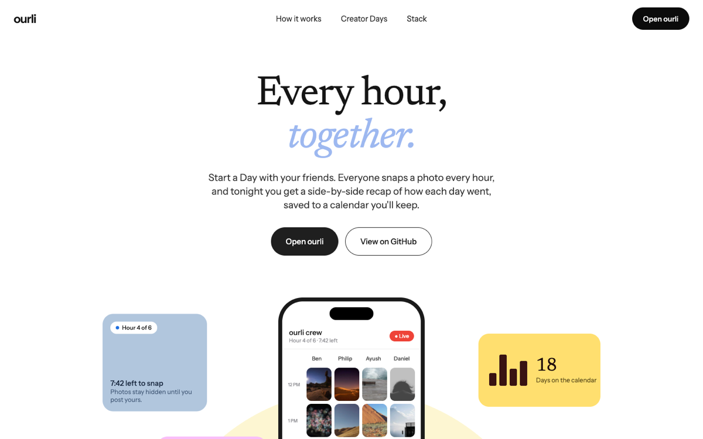
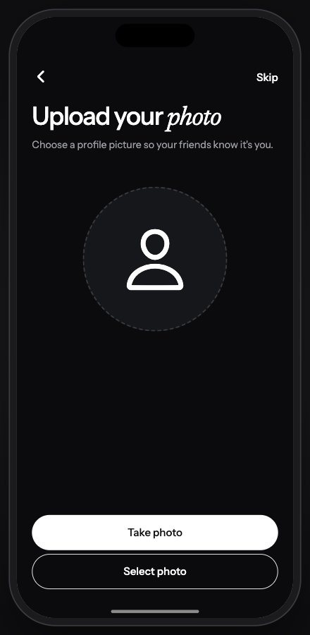
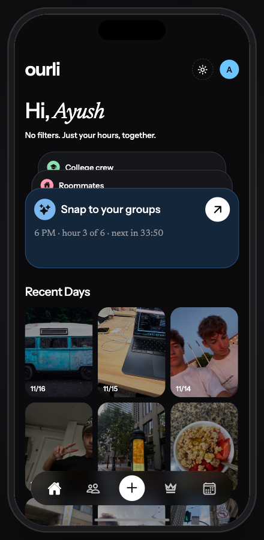
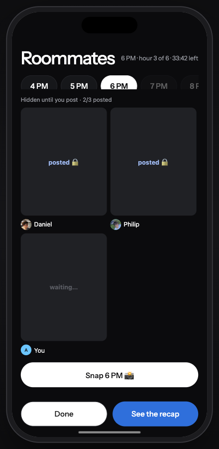
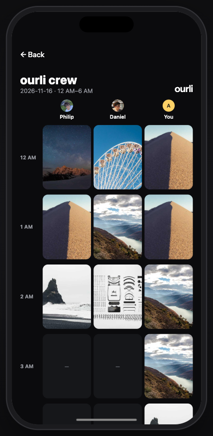
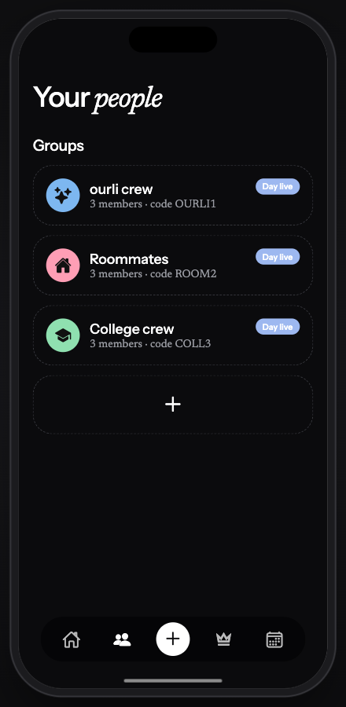
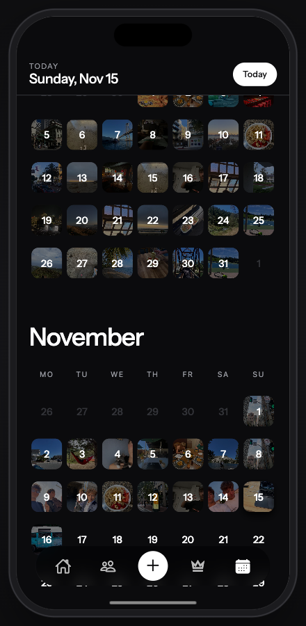
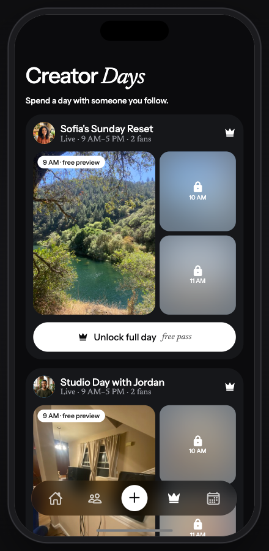
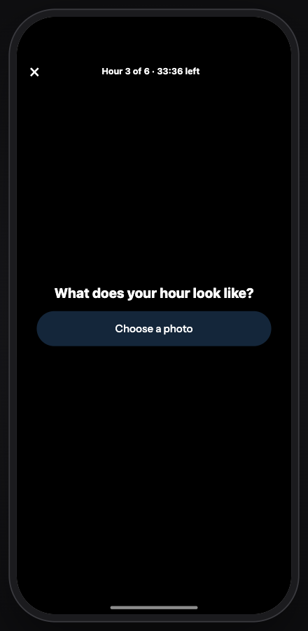

<p align="center">
  
</p>

<h1 align="center"><b>our</b>li</h1>

<p align="center"><strong>Every hour, together.</strong></p>

<p align="center">
  Start a Day with your friends. Every hour, everyone snaps a photo. Each hour's photos stay hidden until you post yours, then reveal side by side. At night you get an hour-by-hour recap, saved to a shared calendar that becomes your group's memory archive.
</p>

<p align="center">
  <a href="https://ourli.ayushojha.com/"></a>
</p>

<p align="center">
  
  
  
  
  
  
  
</p>

<p align="center">
  <a href="https://ourli.ayushojha.com/"><b>Live web demo</b></a> ·
  <a href="https://ourli.wasmer.app/"><b>Mirror</b></a> ·
  <a href="#-sponsors-and-how-we-used-them"><b>Sponsors</b></a> ·
  <a href="#-run-it"><b>Run it</b></a>
</p>

<p align="center">
  
</p>

---

## 💡 The idea

Group chats already do this by hand: someone posts their lunch, someone else their commute, and the day gets lost in the scroll. ourli turns it into a ritual with rules that make it fun.

- ⏰ **A ping every hour.** Tapping it opens that Day. Snap anytime in the hour, no filters.
- 🙈 **Hidden until you post.** An hour only reveals once you've posted yours or the hour closes, so nobody peeks.
- 🖼️ **Reveal side by side.** Everyone's photo for the same hour lands in one row, live.
- 🗓️ **Keep the memory.** Tonight's recap is an hour-by-hour grid that becomes a tile on your group's calendar.
- 👑 **Creator Days.** Creators run a Day with their Whop members: fans sign in with Whop, ourli checks they hold the creator's product, and every hour they see the creator's photo next to their own.

## 📸 Screenshots

<table>
  <tr>
    <td align="center"><br><sub>Join with an invite code</sub></td>
    <td align="center"><br><sub>Home</sub></td>
    <td align="center"><br><sub>A live Day, hidden until you post</sub></td>
    <td align="center"><br><sub>The hour-by-hour recap</sub></td>
  </tr>
  <tr>
    <td align="center"><br><sub>Groups</sub></td>
    <td align="center"><br><sub>Calendar of Days</sub></td>
    <td align="center"><br><sub>Creator Days</sub></td>
    <td align="center"><br><sub>Snap this hour</sub></td>
  </tr>
</table>

## 🎟️ Try it

- **On the web:** open [ourli.ayushojha.com](https://ourli.ayushojha.com/), click **Open ourli**, tap **Get started with an invite code**, enter **`OURLI1`** and your name, then **Skip** the photo. You land on Home with a live demo crew.
- **Mirror:** the same build is also served at [ourli.wasmer.app](https://ourli.wasmer.app/).

## 🤝 Sponsors and how we used them

| Sponsor | What it does in ourli |
| :-- | :-- |
| **Capy** | We built the whole app in Capy, from the first screen to the Convex functions. |
| **Convex** | The backend (`convex/`): the schema, reactive queries that flip each hour from hidden to revealed in real time, file storage for every photo, a scheduled function that closes each Day and picks its cover, and HTTP actions for Sign in with Whop (OAuth 2.1 + PKCE) and the Whop access check. |
| **Revyl** | Cloud iOS builds and AI device tests. `.revyl/config.yaml` builds a simulator `.app` in Revyl's cloud, and `.revyl/tests/` holds the flows Revyl runs on a cloud iPhone: invite-code signup to Home, tabs/Day/Calendar, and the capture screen. Proof of Changes is on, so every pull request gets built, exercised on a device and checked with screenshots. |
| **Whop** | Creator Day access: fans sign in with Whop and ourli checks they hold the creator's product before unlocking the full Day. |

## 🧱 Stack

- Expo SDK 58 / React Native, Expo Router (`src/app`)
- Convex (`convex/`) for data, realtime, storage, scheduling and HTTP actions
- Local notifications for the hourly ping (`expo-notifications`)
- Revyl (`.revyl/`) for cloud builds and device tests

## 🛠️ Run it

```bash
npm install
npx convex dev        # creates/links a Convex deployment and writes .env.local
npx expo start
```

Whop Creator Days need `WHOP_CLIENT_ID`, `WHOP_API_KEY` and `WHOP_PRODUCT_ID` set in the Convex deployment, with `<CONVEX_SITE_URL>/whop/callback` registered as the app's OAuth redirect URI. Without them, the join page offers a demo-mode join.

### Device tests with Revyl

```bash
brew install RevylAI/tap/revyl
revyl auth login
revyl build --profile preview --platform ios --remote   # cloud simulator build
revyl test run signup-to-home                           # or tabs-day-calendar, snap-capture
```
